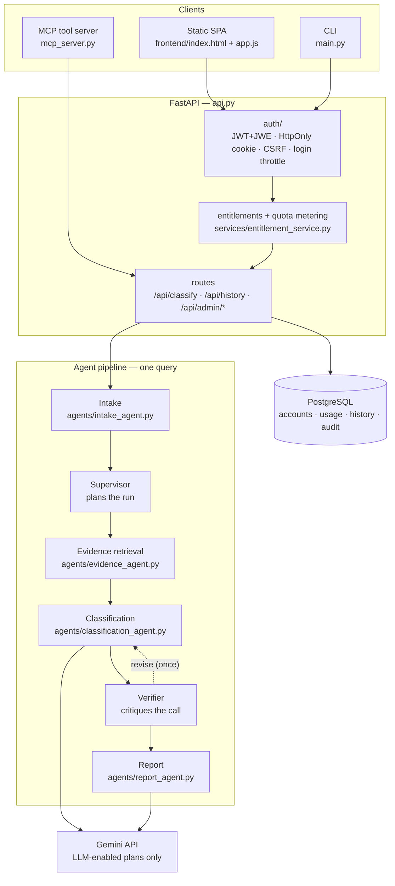
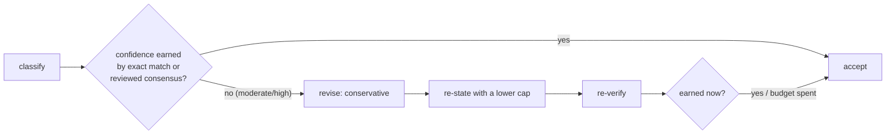
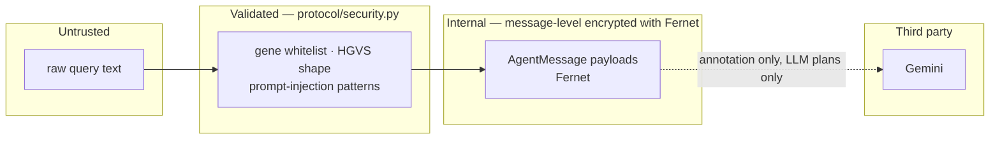

# Architecture

VariantLens answers one question: *for this BRCA1/BRCA2 variant, what does the
evidence support, how sure are we, and on what basis?* It answers it with four
specialist agents under a supervisor, a verifier that can send a call back once,
and an audit trail that records every hop.

## The whole system

Three entry points share one pipeline. The HTTP layer owns accounts, plans and
persistence; the pipeline itself is stateless, which is why one instance serves
every request.

## Why the pipeline is split this way

Each agent owns one kind of judgement, and the split follows the evidence rather
than the code:

| Stage | Owns | Does not |
| --- | --- | --- |
| **Intake** | Parsing the question: gene, HGVS, position, rsID, query type | Touch the dataset |
| **Supervisor** | The plan: retrieval breadth, verification strictness, revision budget | Retrieve or judge |
| **Evidence** | Candidate generation and relevance ranking | Classify |
| **Classification** | The ACMG-style call and the confidence it earns | Write the prose |
| **Verifier** | Whether the confidence is justified by the evidence retrieved | Look at the world afresh |
| **Report** | The human-readable narrative and disclaimer | Change the call |

The boundary that matters most: **the Verifier never re-retrieves.** It checks
internal consistency — is a `high` call backed by an exact match or a reviewed
ClinVar consensus? — and its only lever is to ask for a *more conservative*
re-statement. A verification stage that could go looking for new evidence would
be a second retriever with its own failure modes; a stage that can only withdraw
confidence cannot manufacture it.

## The agentic part

A four-stage chain that always runs in the same order is a pipeline, not agency.
Two things make this one agentic, and both are visible in the audit trail:

1. **Planning is data-dependent** (`agents/orchestrator.py` → `SupervisorAgent`).
   A bare HGVS, an rsID or a position with no gene cannot produce an exact match
   by construction, so the Supervisor widens retrieval for those queries and
   tells the Verifier to tolerate a non-exact match. A gene+HGVS query gets
   targeted retrieval and strict verification. The plan carries the revision
   budget, so the loop's bound is part of the recorded reasoning rather than a
   constant buried in code.
2. **The result can be rejected** (`VerifierAgent`). When a moderate or high
   confidence is not earned, the Verifier returns `revise` with a directive; the
   Classification Agent re-states the call through
   `apply_conservative_directive`, and the Verifier re-checks. **At most one
   round** — a run can never loop, and `revision_rounds` is reported.

The directive is a *cap*, not an edit: it can only lower the number, and because
the label is derived from the number, the label follows. It never changes the
categorical call, because whether a variant is Pathogenic or VUS is an evidence
judgement that a consistency check is not entitled to overturn.

## Trust boundaries

Four boundaries, each enforced in one place:

- **Untrusted input** is sanitised before any agent or model sees it
  (`protocol/security.py`). This reduces the prompt-injection surface; it does
  not eliminate it, which is why the LLM's output is schema-validated and
  reconciled against ClinVar instead of trusted.
- **Between agents**, payloads are encrypted (`protocol/message.py`). The key is
  generated per process — in-process confidentiality, not a managed secret. See
  the limitations in [../SECURITY.md](../SECURITY.md).
- **Out to Gemini**, only variant annotation and ClinVar labels leave, and only
  on plans with `llm_enabled`. No personal data is in the request schema.
- **Inward from the database**, nothing is trusted: deactivation and role are
  read from the account row on every request rather than from the token, so a
  revoked account loses access immediately.

## The report is deterministic-ish on purpose

Every stage that produces prose also produces the structured fields the prose
describes. The narrative is generated from those fields, not the other way
round, so the report can always be checked against the numbers. When the LLM is
unavailable the same fields render through a template path — the pipeline
degrades to a rule-based answer instead of failing
(`tests/test_llm_resilience.py`).

## Where state lives

The agents hold no per-query state. Everything durable is in PostgreSQL:

| Concern | Table |
| --- | --- |
| Who the user is, what plan they are on | `users`, `plans` |
| What they are allowed to do, and what they have used | plan entitlements, `usage_records` |
| What they asked, and what came back | `query_history` |
| Who did what, when | `auth_events` |
| Machine credentials | `api_keys` |
| Clinical sign-off | `review_signoffs` |
| Plan changes in flight | `upgrade_requests` |
| Password reset codes | `password_resets` |

[data-model.md](data-model.md) covers the relationships and the retention rules.

Two consequences of statelessness worth knowing:

- **Per-query caching is keyed by user.** `main.py` caches a whole result, and
  the key includes the account id, so a cached answer can never cross accounts
  (`tests/test_cache_isolation.py`).
- **Scaling is horizontal, with one exception.** Accounts, quotas and rate limits
  are per-process in one place: `auth/rate_limit.py` keeps its counters in
  memory, which is correct for the single-process uvicorn this project runs and
  wrong behind several workers. That is the first thing to change before scaling
  out.

## Frontend

A static single-page app — `index.html`, `app.css`, `app.js`, no build step and
no framework. The server serves it from `/static` and maps URL slugs to views
(`FRONTEND_VIEWS` in `api.py`), so the client and server agree on what a real
page is rather than on a typo.

`tests/test_frontend.py` enforces a contract rather than a style: every CSS class
used in the HTML or JS must be styled, every function called must be defined, and
every destructive action must ask for confirmation before it calls `authFetch`.
That is what keeps a three-file frontend reviewable as it grows.
