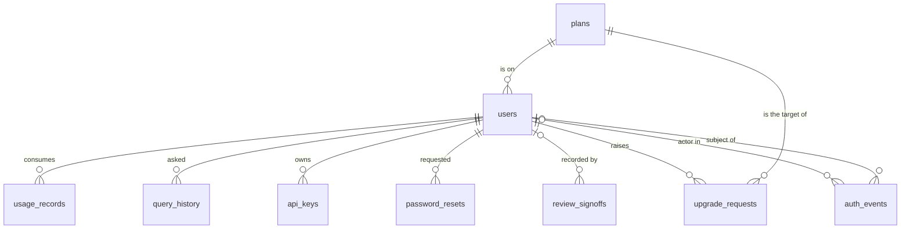

# Data model

Nine tables, all in PostgreSQL. The schema is owned by Alembic
(`migrations/versions/`); the ORM models live in `db/models.py` and the test
suite builds its schema from `Base.metadata.create_all`, so a model change
without a migration passes CI and breaks a real deployment — always add both.

## Accounts and access

### `plans`

| Column | Notes |
| --- | --- |
| `name` | unique |
| `price_cents` | `NULL` means "custom pricing" (Enterprise), not free |
| `monthly_query_limit` | `NULL` means unlimited |
| `llm_enabled` | whether the pipeline may call Gemini on this plan |
| `api_access` | whether machine credentials can be minted |
| `audit_export` | whether the compliance log can be exported |

Entitlements are a property of the plan row, resolved server-side on every
request. The client is never asked what it is allowed to do.

`price_cents` being nullable rather than zero is deliberate: `NULL` and `0` mean
different things, and a `0` would make Enterprise sort below Free in any
price-based comparison. The profile page ranks plans on this column
(`renderPlanBox` in `frontend/app.js`) to decide what is an upgrade, which is
why the distinction matters in the UI too.

### `users`

| Column | Notes |
| --- | --- |
| `username`, `email` | both unique, both indexed |
| `password_hash` | Argon2id via `pwdlib`. Plaintext is never stored or logged |
| `role` | `clinician` or `admin` — checked server-side, never read from a token |
| `plan_id` | FK → `plans`, `lazy="joined"` (every request needs it) |
| `is_active` | checked on every request, so deactivation is immediate |
| `full_name`, `created_at` | profile display |

### `api_keys`

| Column | Notes |
| --- | --- |
| `key_hash` | SHA-256 of the presented key, unique and indexed. The plaintext is shown once and never recoverable |
| `prefix` | first 12 characters in clear, so a user can tell two keys apart in the UI |
| `last_used_at` | updated on each authenticated call |
| `revoked_at` | revocation is a timestamp, not a delete |

Keys are revoked rather than deleted so that "was this key revoked, and when?"
stays answerable for the audit trail. Only a plan with `api_access` can mint one.

### `password_resets`

| Column | Notes |
| --- | --- |
| `code_hash`, `salt` | the one-time code is stored hashed, like a password |
| `attempts` | bounds guessing at a 6-digit code |
| `expires_at`, `consumed_at` | a code is single-use and short-lived |

## Activity

### `usage_records`

One row per metered request: `request_id` (unique), `query_count`,
`llm_tokens_used`. Quota enforcement reads this table, which is why it is
separate from `query_history` — the quota must be answerable even for rows whose
history was later pruned.

### `query_history`

What the user asked and what came back: `query_text`, `variant_id`, `gene`,
`classification`, `confidence`, `confidence_numeric`, `reasoning_mode`. Scoped
to the owner on every read. An administrator reading another account's history
writes an `admin_read_history` audit event, because reading somebody's query log
exposes what they were investigating.

### `auth_events`

Append-only. The columns that matter:

| Column | Notes |
| --- | --- |
| `event_type` | one of 14 values, validated by a non-native enum |
| `user_id` | nullable — the events worth recording most (a failed sign-in against a nonexistent address) do not resolve to an account |
| `actor_user_id` | who performed the action, when that differs from who it happened to (an admin resetting someone's password) |
| `identifier_hash` | a digest, salted with the JWT signing key, never the raw address |
| `client_ip`, `user_agent` | bounded to 64 and 256 characters |
| `detail` | bounded to 500 characters |

Two design rules are load-bearing. **Auditing must never break the operation it
describes** — a failed insert is swallowed and logged
(`auth/audit.py`). And **identifiers are keyed hashes**: a plain SHA-256 of an
email address is reversible by hashing a wordlist, and this table holds attempts
against addresses that may belong to nobody.

## Workflow

### `review_signoffs`

One row per variant (`variant_id` unique) — re-signing updates in place rather
than appending, so the current state is always exactly one row.

`reviewer_name` is the human who signs and may not be the account holder (a
counselor signing on behalf of a clinician); `reviewed_by` is the authenticated
account that recorded it, with `ondelete="SET NULL"`. **Deleting an account must
not be able to erase a clinical attestation** — the sign-off survives with its
name and date intact.

### `upgrade_requests`

`user_id` → `plans.id` as `target_plan_id`, plus `note`, `status`
(`pending`/`contacted`/`approved`/`declined`), `admin_note`, and
`created_at`/`updated_at`/`decided_at`. `is_open` is a property, not a column, so
the definition of "still waiting" cannot drift from the query that filters on it.

**No payment is taken anywhere.** An upgrade is a request a human decides on,
which is why the table records a decision rather than a transaction.

## Retention and deletion

**There is no account-deletion path in the application.** The only delete route
is `DELETE /api/keys/{id}`, which is a revoke (a timestamp), not a delete. So
the retention rules below describe intent and the cascades that are declared,
not a flow a user can trigger today.

| Data | Rule |
| --- | --- |
| `query_history` | retained; the user can read their own rows back, and an admin read is audited |
| `usage_records` | retained — quota and billing history |
| `auth_events` | append-only; never edited or deleted by the application |
| `review_signoffs` | survives account deletion by design (`SET NULL` on `reviewed_by`) |
| `password_resets` | expired rows are dead weight and safe to prune |
| `api_keys` | revoked, never deleted |

The cascades are declared at the ORM level (`cascade="all, delete-orphan"` on the
`User` relationships for usage records, query history, API keys, password resets,
upgrade requests and review sign-offs — with review sign-offs explicitly *not*
cascading). Two consequences worth knowing before someone adds a delete endpoint:

- **They are ORM cascades, not database `ON DELETE` rules.** A raw `DELETE FROM
  users` would orphan the child rows rather than removing them.
- **`auth_events` has no cascade and its `user_id` is a plain FK.** A raw delete
  of a user row with events against it would violate that foreign key. The
  append-only audit trail is meant to outlive the account, so a real deletion
  feature has to decide explicitly whether to null the reference or refuse the
  delete — either is defensible, silently failing is not.

There is no soft-delete flag for accounts either. Deactivation is `is_active`,
which is what a deleted account would need to become anyway; a second "really
deleted" state on top of it invites confusion about which one a row is in.

## Migrations

| Revision | Change |
| --- | --- |
| `0001_initial_schema` | `plans`, `users`, `usage_records` |
| `0002_review_signoffs` | clinical sign-offs move out of a local JSON file |
| `0003_password_resets` | one-time reset codes |
| `0004_upgrade_requests` | plan-change requests |
| `0005_auth_events` | the append-only security record |
| `0006_api_keys` | machine credentials |
| `0007_query_history` | query history, plus the widened `auth_events` check constraint for `admin_read_history` |

A new event type in `AUTH_EVENT_TYPES` needs a migration: the enum is stored as a
validated string with a CHECK constraint, so widening the tuple in
`db/models.py` without a matching revision produces a model the database will
reject.
