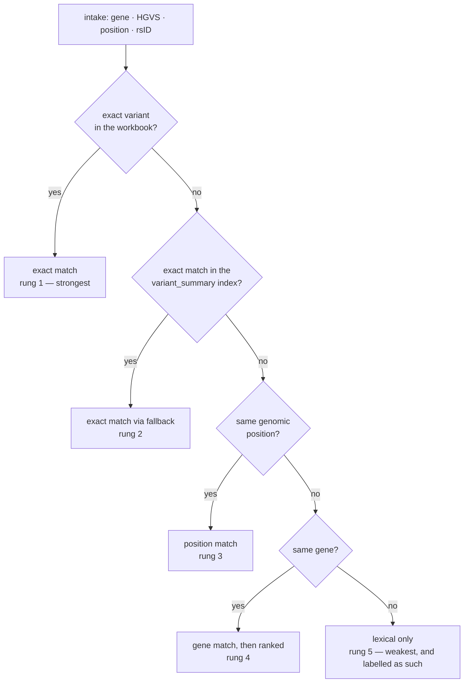

# Retrieval and ranking

Retrieval is the stage where this system can be most obviously wrong and least
obviously caught: a plausible-looking answer built on the *wrong* variant row is
harder to notice than a crash. So the retrieval path is built as a ladder of
increasingly weak evidence, each rung labelled, and it reports which rung the
answer came from.

Code: `agents/evidence_agent.py` (retrieval and scoring), `retrieval/` (the
models and the metrics, importable with no agent dependencies).

## The corpus

| Source | Contents | Role |
| --- | --- | --- |
| `data/clinvar_variant_dataset_enriched.xlsx` | ~3,000 BRCA1/BRCA2 rows, all with **conflicting** ClinVar classifications, enriched with the real `ClinicalSignificance`, review status and stars | The primary corpus. Rows are documents built from gene, HGVS, consequence, impact, disease, predictor calls and variant type |
| `data/variant_summary_brca.tsv` | Built from ClinVar's `variant_summary.txt.gz` | Fallback for well-known clean variants that the study workbook does not contain (e.g. BRCA2 `c.5946delT`) |

The fallback exists because the workbook's conflicting-classification filter
excludes exactly the well-known, unambiguously classified variants a user is most
likely to ask about. Without it, those queries answered from loose same-gene
similarity and reported an unrelated row. When the answer comes from the
fallback, the payload says so (`coverage_fallback`).

## The ladder



Every rung fills the same `top_k_results` payload, and each result carries its
own `match_type`, `relevance_score` and `relevance_explanation`. A user reading a
`Same gene` answer knows they are looking at a neighbour of what they asked for,
not an answer about it.

**The exact rungs short-circuit the lexical models entirely.** That is the
correct behaviour — if the variant is in the corpus, ranking by text similarity
is a strictly worse way to find it — but it also means a pipeline-level
comparison of TF-IDF against BM25 returns three identical numbers. The ranker
comparison below exists because of that.

## The three lexical rankers

`RANKERS = ("tfidf", "bm25", "hybrid")`. The default is `tfidf`, so the live
behaviour is unchanged from before BM25 existed; select another with the
`ranker=` argument or the `VL_RANKER` environment variable.

### TF-IDF cosine similarity

scikit-learn's `TfidfVectorizer` (lowercased, `\b[a-zA-Z0-9_]+…\b` tokens,
capped at 5,000 features) over the concatenated `search_text` field, scored by
cosine similarity. Bounded in [0, 1], which is why it feeds the relevance score
unscaled.

### BM25 (Okapi) — hand-rolled

`retrieval/bm25.py`: k₁ = 1.2, b = 0.75, Lucene's IDF form

```
idf(t) = ln(1 + (N − n(t) + 0.5) / (n(t) + 0.5))
score  = idf(t) · f(t,d)·(k₁+1) / (f(t,d) + k₁·(1 − b + b·|d|/avgdl))
```

Two deliberate choices:

- **The `+1` inside the logarithm is not cosmetic.** The unsmoothed Robertson–
  Spärck Jones IDF goes *negative* for a term appearing in more than half the
  corpus, which would make a document score **lower** for containing a query
  term. On a corpus this small and this homogeneous — every document is a BRCA
  variant — that is not a corner case. `tests/test_retrieval.py` asserts the
  positive IDF directly.
- **It is hand-written rather than a dependency.** The alternative is
  `rank_bm25`, an unmaintained package for ~80 lines of arithmetic; writing it
  means the formula in the report and the formula in the code are the same
  object, and the test suite can hand-compute a score (`0.90665` for the
  documented three-document corpus) and assert it.

BM25 is not bounded — it scales with corpus size and query length — so when it
feeds the relevance score it is max-normalised within the candidate batch first.

### Hybrid — Reciprocal Rank Fusion

`retrieval/fusion.py`: RRF (Cormack, Clarke & Büttcher, 2009) with k = 60.

```
score(d) = Σ_r 1 / (k + rank_r(d))
```

**Why ranks and not scores:** cosine is bounded in [0, 1] and BM25 is unbounded
and corpus-dependent — a BM25 score of 12 might be strong in one corpus and weak
in another. Averaging them, or weighting one by a constant, silently assumes a
comparability that does not exist. RRF never looks at a score, so the scale
problem disappears. A document both models rank mid-table beats one that only a
single model liked, which is the property that makes RRF robust when one model is
confidently wrong.

k = 60 is Cormack et al.'s value, reported to be insensitive between roughly 10
and 100. It is fixed rather than exposed as a knob: a constant with a published
justification is easier to defend than a tuned parameter.

`score_fusion` (max-normalised averaging) is implemented and tested but **is not
used by the live pipeline**. Max-normalisation rather than min–max: min–max maps
the worst candidate to 0 and the best to 1 whether or not either is good, so a
batch of uniformly weak matches still produces a candidate that reads as a
perfect hit. Dividing by the maximum keeps a weak batch weak.

## The relevance score

`_rank_candidates` computes a weighted sum per candidate:

| Component | Range |
| --- | --- |
| exact variant match | +10 |
| same gene | +5 |
| same genomic position | +5 |
| HIGH impact | +2 |
| conflicting classification | −2 |
| evidence completeness | 0 … +6 |
| lexical similarity (active ranker) | 0 … +5 |
| ClinVar review data present | +1 |
| **theoretical maximum** | **34.0** |

The lexical term is capped at 5 for every ranker, so **switching rankers cannot
move the ceiling** — a change in the ranking is a change in the ordering, not in
the scale. The live relevance numbers are byte-identical to the pre-BM25
behaviour when the default ranker is in use, which is why no existing expectation
moved.

Scores are then normalised to 0–1 for display. The raw score is what orders the
list; the normalised one is what a human reads.

## Ranking metrics

`retrieval/metrics.py` implements, over a list of relevance grades
best-ranked-first:

| Metric | Reads | Answers |
| --- | --- | --- |
| `precision_at_k` | presence | of the k shown, how many were relevant? (denominator is k, not the list length) |
| `recall_at_k` | presence | of everything relevant, how much did the top k hold? |
| `average_precision_at_k` | **rank** | precision averaged at each rank where a relevant document sits — finding it first beats finding it tenth |
| `ndcg_at_k` | **rank** | discounted gain against the ideal ordering; supports graded relevance via 2^g − 1 |
| `reciprocal_rank` | **rank** | 1/rank of the first relevant document |

**The degeneracy, stated rather than hidden.** For an exact-variant query there
is exactly one relevant document. `recall@k` is therefore 1.0 or 0.0,
`MAP@k` is numerically `MRR@k`, and `nDCG@k` is a monotone function of the rank.
Reporting those four as four independent findings would be dishonest, and the
report says so. They are computed anyway because they are the standard
definitions and because the ranker comparison below needs to reuse tested
functions rather than a bespoke score.

## The ranker comparison

Because the exact-variant rungs bypass lexical ranking, comparing the three
rankers through the pipeline would compare nothing. The experiment asks the
narrower, answerable question instead:

> Given only the query text, where does each model put the correct row in the
> corpus?

For each sampled variant, all three models score **every row** of the corpus, and
the correct row's rank is `1 + |{documents scoring strictly higher}|` — ties
resolve in the target's favour, which is the best rank the model could have
handed back. TF-IDF and BM25 scores come from the agent's own vectorizer and
index over the same `search_text` field; the hybrid rank is RRF over their two
full rankings. The only thing that differs between the three columns is the
model.

Reported per ranker: MRR@k, nDCG@k, MAP@k, exact-match@k, hit@1, mean rank —
plus **how many queries each ranker put the correct row highest**, which is the
one column not derived from the others.

```bash
# retrieval only: no LLM calls, no labels needed
python evaluation.py --rankers-only --sample-size 50
# or
make evaluate-rankers
```

The measured table, with the numbers this repository actually produced, is in
[../PROJECT_REPORT.md](../PROJECT_REPORT.md) — and the same command regenerates
it. Unit tests for the models and the metrics live in `tests/test_retrieval.py`;
tests for the evaluation's calibration and fairness blocks live in
`tests/test_evaluation_metrics.py`.
