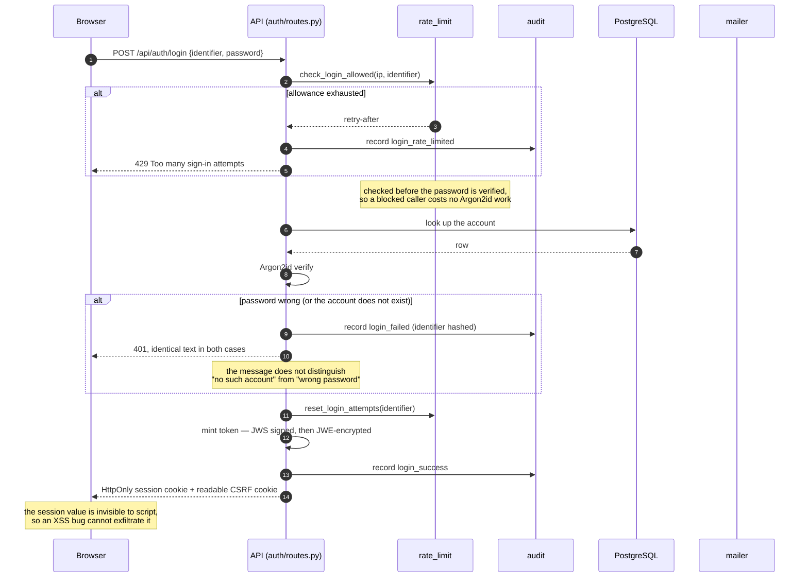

# Sequences

Two flows carry almost all the behaviour: signing in, and asking a question.
Both are drawn from the code as it is, not as it was intended.

## Asking a question

```mermaid
sequenceDiagram
    autonumber
    participant B as Browser (SPA)
    participant A as API (api.py)
    participant S as auth/dependencies.py
    participant E as entitlement_service
    participant O as Supervisor
    participant I as Intake
    participant V as Evidence
    participant C as Classification
    participant R as Verifier
    participant P as Report
    participant DB as PostgreSQL
    participant G as Gemini

    B->>A: POST /api/classify {query}
    A->>S: resolve caller (cookie / bearer / X-API-Key)
    S->>DB: re-read the account row
    DB-->>S: row (role, plan, is_active)
    Note over S: deactivation applies immediately,<br/>even to an unexpired token
    S-->>A: User
    A->>E: llm_enabled? quota available?
    E-->>A: allowed
    A->>A: cache key = (query, account, plan)

    A->>I: raw query
    I-->>A: gene · HGVS · position · rsID · query_type
    Note over I: sanitised and structurally validated<br/>before any agent or model sees it

    A->>O: plan(intake)
    O-->>A: retrieval_mode · strictness · revision budget
    Note over O: a bare HGVS or rsID cannot match exactly,<br/>so retrieval widens and verification loosens

    A->>V: retrieve(query)
    Note over V: the corpus is held in-process —<br/>the annotated workbook plus the<br/>ClinVar variant_summary fallback index
    V-->>A: evidence + top-k + ir_metadata

    A->>C: classify(evidence)
    opt LLM-enabled plan and the case is not clear-cut
        C->>G: annotate / reason
        G-->>C: structured suggestion
        Note over C: schema-validated, then reconciled<br/>against ClinVar consensus
    end
    C-->>A: classification + confidence (numeric + label)

    A->>R: verify(evidence, classification)
    Note over R: checks internal consistency only:<br/>is the confidence earned by the evidence?

    alt confidence not earned by an exact match or reviewed consensus
        R-->>A: revise → "conservative"
        A->>C: classify(evidence, directive=conservative)
        Note over C: cap the number; the label follows.<br/>The categorical call does not change.
        C-->>A: revised classification
        A->>R: verify(evidence, revised)
    end
    R-->>A: accept

    A->>P: generate_report(evidence, classification)
    P-->>A: narrative + evidence summary
    A->>A: assemble audit trail from the message log

    A->>DB: usage_records + query_history
    A-->>B: report · classification · confidence · audit_trail · plan/usage
```

Three properties are worth naming, because they are the ones that break when
someone "simplifies" the pipeline later:

- **The LLM is never the source of truth.** It is consulted inside
  `<classification>` for cases the rules do not settle, its output is validated
  against a schema, and the result is then reconciled against the ClinVar
  consensus. Every path that skips the LLM still produces a complete answer.
- **The revision loop is bounded to one round.** `revision_rounds` is reported,
  so a reader can tell whether the verifier accepted the first call or asked for
  a second.
- **The audit trail is built from messages, not from a logging side channel.**
  Each stage already recorded an `AgentMessage`; the trail is those messages
  projected for a reader.

## Signing in



The "deactivated account" check sits after the password check, and it does return
a distinct message (`Account is deactivated.`). That does tell a caller the
account exists — but only to a caller who has already proved they hold the
password, and hiding it would leave a deactivated user staring at "invalid email
or password" with no explanation. The enumeration risk the merged 401 protects
against is at the pre-authentication step, and that one is still merged.

The CSRF cost of using a cookie is paid on the way back in:
`auth/cookies.py` requires a double-submit `X-CSRF-Token` on any state-changing
request that was authenticated *by cookie*, and skips the check for bearer
tokens, which are never attached ambiently. See `AUTH.md` for the full
treatment.
